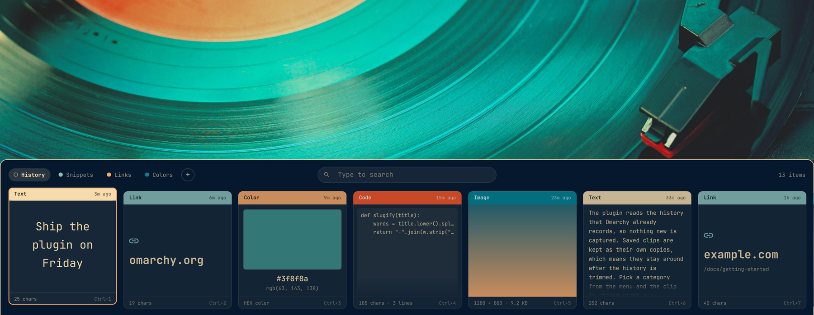
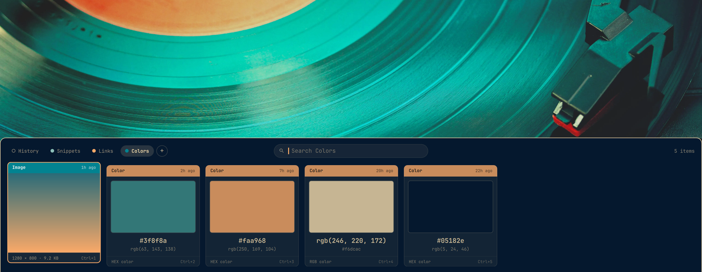
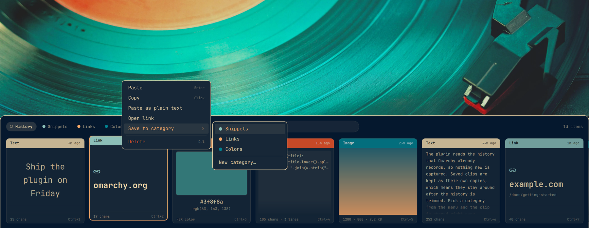
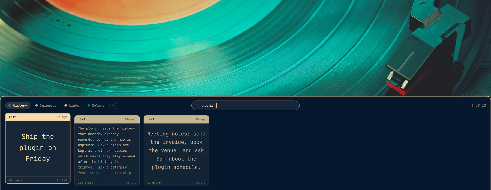

# OmaPegui

OmaPegui is a clipboard history panel for the Omarchy shell. It slides up from the bottom edge of the screen as a strip of cards, newest on the left, with search, saved categories, and a context menu on every card. It does not capture anything itself: it shows the history that Omarchy's built-in clipboard plugin already records, and keeps its own copies of the clips you choose to save.









## Features

- A strip of cards along the bottom edge, one per clipboard entry, newest first, scrolling sideways.
- Each card shows what kind of item it is (text, link, image, color, code, files), how long ago it was copied, a preview, and a size.
- Type anywhere to filter. The search runs inside the tab that is open.
- Click a card to copy it and close the panel. Press Enter to paste it into the window that had focus.
- Right-click a card for Paste, Copy, Paste as plain text, Open link, Save to category, and Delete.
- Categories: save clips into named, colored tabs. A saved clip is its own copy, so it stays after Omarchy trims its history.
- Keyboard and mouse both work for everything, including the menus.
- Follows the active Omarchy theme for colors and fonts.
- Clicking anywhere outside the strip closes it.

## Requirements

- Omarchy 4.5 (built and tested on Omarchy 4.5 with Quickshell 0.3.2 and Hyprland 0.56). Other versions are untested.
- Omarchy's built-in clipboard plugin (`omarchy.clipboard`) must stay enabled. OmaPegui reads the history file it writes (`~/.local/state/omarchy/clipboard-history.json`) and the images it saves.
- `wl-clipboard` (`wl-copy`) and `wtype`. The built-in clipboard panel uses the same two tools, so they are normally already installed.
- `bash`, the coreutils (`stat`, `realpath`, `mktemp`) and `file`, used by the helper scripts.
- `xdg-utils` (`xdg-open`), only for the Open link action.

## Install

```
omarchy plugin add https://github.com/rickeyfaneite/omapegui.git --enable
```

Then restart the shell once so it loads the plugin:

```
omarchy restart shell
```

## Keybinding

OmaPegui does not bind a key by itself. To open it with Super+Shift+P, put this line in `~/.config/hypr/bindings.lua`, replacing the line for the built-in clipboard manager if you have one:

```lua
o.rebind("SUPER + SHIFT + P", "OmaPegui", { panel = "io.github.rickeyfaneite.omapegui" })
```

Reload Hyprland's configuration:

```
hyprctl reload
```

You can also toggle the panel from a terminal with `omarchy-shell shell toggle io.github.rickeyfaneite.omapegui`.

## Usage

| Key or action | What it does |
| --- | --- |
| Type any text | Filters the cards in the open tab |
| Left, Right | Move the selection |
| Home, End | Jump to the first or last card |
| Page Up, Page Down | Move several cards at a time |
| Enter | Paste the selected card into the window that had focus |
| Ctrl+1 to Ctrl+9 | Paste the nth card of the ones currently in view |
| Delete | Delete the selected entry from the history, or remove it from the category |
| Esc | Clear the search; with nothing to clear, close the panel |
| Backspace, Ctrl+Backspace, Ctrl+U | Edit the search text (one character, one word, everything) |
| Tab, Shift+Tab, Ctrl+Left, Ctrl+Right | Switch between History and the categories |
| Menu key, Shift+F10 | Open the context menu for the selected card |
| F2 | Rename the open category |
| Shift+Left, Shift+Right | Move the selected clip within a category |
| Click a card | Copy it, show "Copied", and close the panel |
| Right-click a card | Open its context menu |
| Hover a card | Select it, so the ringed card is the one a click will take |
| Mouse wheel | Scroll the strip sideways |
| Click a tab | Switch to it |
| Right-click a tab | Rename, change color, or delete the category |
| Click "+" | Create a category |
| Click outside the strip | Close the panel (with a menu open, a click elsewhere on the strip closes only the menu) |

In a menu, the arrow keys move, Right or Enter opens a submenu or runs the item, Left closes a submenu, and Esc closes only the menu.

## Categories

Save to category in the context menu stores a copy of the clip in the category you pick. Choose New category to create one on the spot. Text clips can be up to 1 MiB. A category can be renamed, given another color from the theme, or deleted; deleting asks once.

Saved data lives in `~/.local/state/omarchy/omapegui/`:

- `categories.json` holds the categories and the text clips.
- `images/` holds the copies of saved images.
- `times.json` holds the "copied x ago" labels for history entries.
- `salt` is a random value used to label those entries (see below).

## Privacy and security

- Nothing is sent over the network. The only thing the plugin launches besides its own helper scripts is `xdg-open`, and only when you choose Open link on an http or https link.
- The state folder and its `images` folder are created with mode 0700 and set to 0700 again every time the plugin loads. The JSON files and the salt are 0600. If the state folder is a symlink or is not owned by you, the plugin does not use it and shows a message in the panel.
- Saved clips are kept in plain text, as is, until you remove them. They outlive the built-in history on purpose, so do not save anything you would not want to find on disk later.
- Entries that a password manager marks as sensitive are skipped by Omarchy's capture, so they never reach the history and never reach the panel.
- `times.json` does not contain clipboard text. Its labels are a keyed hash of a short prefix of each entry and its length, keyed with the random salt. Someone who can read the folder can read the salt too, so the folder permissions are what protect it. Deleting `salt` only loses the old "x ago" labels.
- Text is never typed into a window key by key. Paste and Paste as plain text both put the text on the clipboard and send Shift+Insert, so the receiving program's own paste handling applies (for example bracketed paste in a terminal).
- The helper scripts only touch Omarchy's `clipboard-images` folder and the plugin's own `images` folder. They refuse symlinks, files outside those folders, and file names that are not of the form Omarchy generates. Images are pasted or saved only if they are PNG, JPEG, WebP or GIF.
- Images are put on the clipboard by the plugin's own helper (`wl-copy --type <image type>`), and the paste gesture is sent only if that succeeded.
- The checks described here are there to contain mistakes and malformed data. They are not a defense against another program already running as your user, which could change these files between a check and their use.
- Limits: a saved set larger than 12 MiB, or more than 50 categories, is refused; a history or categories file larger than 16 MiB is not read, at most 500 history entries are held in memory, previews are skipped for images over 20 MiB or 40 megapixels, and links open only if they are http or https.

## Known limitations

- Deleting an entry from the history rewrites Omarchy's history file. A capture that lands in the very same instant can be lost. The built-in panel has the same window.
- Paste goes to whichever window has focus when the paste fires, a fraction of a second after the panel closes. If you change focus in that moment, it goes there.
- File reads and writes are synchronous, so a very large saved set can make the shell pause briefly while it is saved.
- The shell does not reload a plugin when its files change. After updating the plugin, restart the shell with `omarchy restart shell`.
- Some terminals, such as foot, treat Shift+Insert as a paste of the primary selection instead of the clipboard, so pasting from the panel may not land there. Copying with a click and pasting yourself works everywhere.
- Image previews appear only once the image has been inspected, so a card may show a placeholder for a moment when the panel opens.

## Uninstall

```
omarchy plugin disable io.github.rickeyfaneite.omapegui
omarchy plugin remove io.github.rickeyfaneite.omapegui
```

Change the key binding back to `{ panel = "omarchy.clipboard" }` and run `hyprctl reload`. Saved clips stay on disk until you delete the folder:

```
rm -r ~/.local/state/omarchy/omapegui
```

## License

MIT. See [LICENSE](LICENSE).
